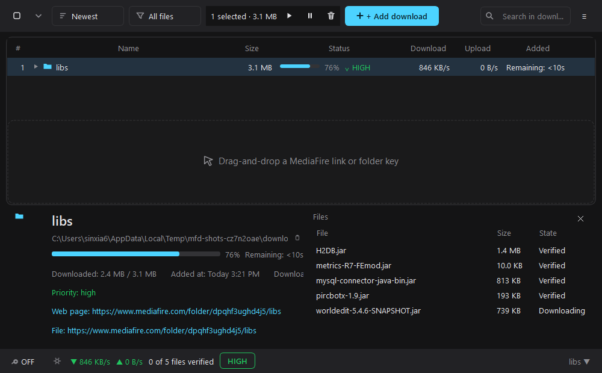
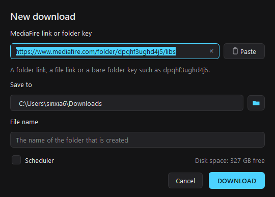
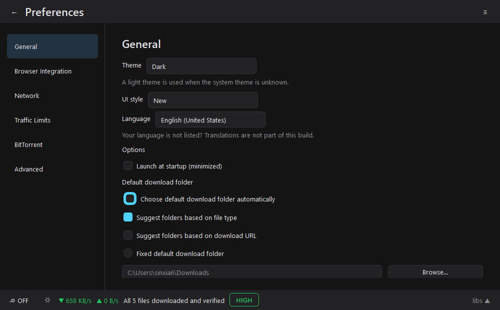

# ArkLoad

**Modern Download Manager** - a desktop download manager for **MediaFire** folders and files,
with a dark interface in the style of the new Free Download Manager.

ArkLoad is a normal Windows application: it installs with a setup program, keeps its data in your
user profile and needs no Python of its own.



## What it does

* **Downloads whole folders** - a MediaFire folder link is expanded into every file and
  sub-folder, with a file filter (`*.jar`, `mods/*`, …) if you want only some of them.
* **Resumes** - an interrupted transfer continues at the byte it stopped at, after a crash, a
  restart or a lost connection.
* **Detects what is missing** - every file of a download is tracked on its own
  (*missing*, *incomplete*, *downloading*, *completed*, *verification failed*, *failed*), so a
  folder that was only half downloaded is finished instead of started again.
* **Verifies every file** - MediaFire publishes a SHA-256 for each file; ArkLoad compares the
  download with it. A file that does not match is downloaded again and checked again.
* **Downloads several parts of a file at once** (`Connections per file` in the preferences), with
  the state of every part kept on disk, so even a split transfer continues where it stopped.
* **A real speed limiter** - the snail button in the status bar caps the transfer rate.
* **MediaFire folder keys** - a bare key such as `dpqhf3ughd4j5` works as well as a link.
* **Keeps its list** - the downloads, their tags and their priority survive a restart.

## The interface

| | |
|---|---|
|  | The **New download** window: the link, the folder, the name, the scheduler and the free space on the drive. |
|  | The preferences: general, browser integration, network, traffic limits, BitTorrent and advanced. |

The toolbar holds the selection, the sort and the filter, the **+ Add download** button, the
search field and the main menu.  Below it is the list of downloads; at the bottom the status bar
shows the speed limiter, the live speeds, the traffic priority and the selected download.  The
card at the bottom opens with the arrow in the status bar and shows the progress, the speeds, the
path and the links of the selected download.

## Install

Download the setup program from the releases and run it.  It installs into
`%ProgramFiles%\ArkLoad`, adds a Start Menu entry and never touches your downloads
or your settings when you uninstall it.

## Run it from the sources

```bash
pip install -r requirements.txt
python tools/arkload/main.py
```

The classic window (Tkinter, no PySide6 needed) is still there:

```bash
python tools/mediafire_gui.py
```

## Build the Windows application

```powershell
powershell -ExecutionPolicy Bypass -File packaging\build.ps1
```

It creates

| | |
|---|---|
| `dist\ArkLoad\` | the folder build (starts instantly) |
| `dist\ArkLoad.exe` | the single file build |
| `release\ArkLoad-Setup.exe` | the installer (Inno Setup) |

The build needs `pyinstaller` and, for the installer, [Inno Setup 6](https://jrsoftware.org/isinfo.php).

## Use it from the command line

```
ArkLoad.exe --add https://www.mediafire.com/folder/abc123 --destination D:\Mods
ArkLoad.exe --add <url> --headless --exit-when-done
```

`--headless` runs the transfers without a window, which is handy for scripts and for the browser
extension.

## The browser extension

`Main menu → Browser Integration → Create the extension` writes an unpacked extension into
`%LOCALAPPDATA%\ArkLoad\browser-extension`.  Load it in Chrome or Edge ("Load unpacked") and it puts
the MediaFire link of the current page on the clipboard, ready for `Ctrl+V` in ArkLoad.

## Where the data lives

| | |
|---|---|
| Settings | `%LOCALAPPDATA%\ArkLoad\gui-settings.json` |
| Download list and manifests | `%LOCALAPPDATA%\ArkLoad\jobs\` |
| Add-ons | `%LOCALAPPDATA%\ArkLoad\addons\` |
| Log | `%LOCALAPPDATA%\ArkLoad\arkload.log` |

Nothing is ever written into the installation folder.

## Layout

```
tools/arkload/            the PySide6 application
  arkload_window.py       the main window
  download_model.py   the records, the states and the table model
  download_engine.py  the bridge to the downloader
  preferences_view.py the preferences
  dialogs.py          the windows
  styles.py           the palette and the stylesheet
  settings.py         where the data lives
tools/mediafire_dl.py     the downloader (HTTP, ranges, hashes)
tools/mediafire_resume.py the manifests, the status detection, the verification
tools/mediafire_session.py the worker that plans, verifies and downloads a job
tools/mediafire_gui.py    the classic Tkinter window
packaging/             the PyInstaller and Inno Setup configuration
tests/                 the test suite
```

## Tests

```bash
pip install pytest PySide6
pytest -q tests
```

## License

MIT - see [LICENSE](LICENSE).
